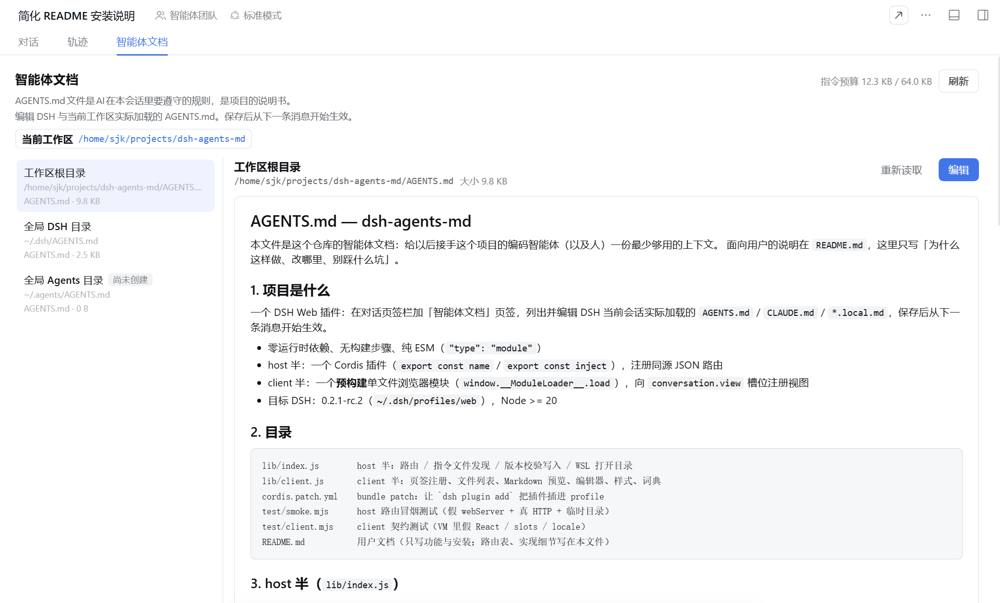

# dsh-agents-md

DSH Web 插件：在对话页签栏加一个「智能体文档」页签，查看并编辑当前会话实际加载的 `AGENTS.md` 指令文件，保存后从下一条消息开始生效。



## 功能

- 列出当前会话加载的全部指令文件：用户级与工作区的 `AGENTS.md` / `CLAUDE.md`
- 侧栏顺序：工作区文件置顶，其次 `~/.dsh/AGENTS.md`，`~/.agents/AGENTS.md` 固定在最下面
- 默认 Markdown 预览，点「编辑」切换到编辑器
- Ctrl/⌘+S 保存，保存后下一条消息生效
- 缺失的 `AGENTS.md` 可直接创建
- 顶部显示工作区路径（点击打开文件管理器）与 64 KiB 指令预算
- 保存前校验版本，文件被外部改过时报冲突而不是覆盖
- 中英文界面，跟随 DSH 语言设置

## 安装

在 DSH Web 的「设置 → 插件」页点「添加插件」，选「安装第三方插件」，在「包名或地址」里填入：

```
github:Sillykjs/dsh-agents-md
```

装完按提示重启 DSH，刷新页面，页签栏即出现「智能体文档」。

保存的指令在**下一条消息**才被重新读取，当前回合不受影响。

## License

MIT
